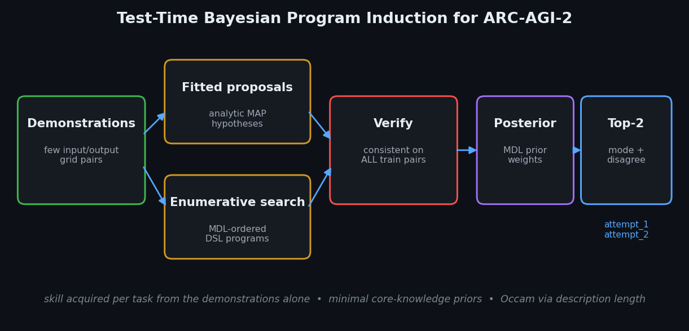

# arc-solver — Test-Time Bayesian Program Induction for ARC-AGI-2

A compact, reproducible solver for the **Abstraction and Reasoning Corpus**
(ARC-AGI-2), built for the [ARC Prize 2026 Paper Track](https://www.kaggle.com/competitions/arc-prize-2026-paper-track).

> **Thesis.** Treat each ARC task as *test-time Bayesian program induction*: from
> only the demonstration pairs, infer a short program over a compositional grid
> DSL that reproduces them all, weight admissible programs by a Minimum
> Description Length (MDL) prior, and — because the metric is pass@2 — emit the
> posterior-**mode** output as `attempt_1` and the most probable *disagreeing*
> output as `attempt_2`.

The method instantiates François Chollet's framing of intelligence as
*skill-acquisition efficiency*: the skill (the program) is acquired per task from
the demonstrations alone, using only minimal, domain-general priors (the DSL
primitives are core-knowledge operations).



## Why it is interesting

- **No pretraining, no data, no network** in the core path — it runs on a CPU
  with only numpy. Generalisation comes from the MDL/Occam prior, not from scale.
- **One interface, three proposers.** Offline analytic + enumerative search is
  the reproducible core; an **LLM-amortised** proposer (Greenblatt/Imbue-style,
  with execution-grounded refinement) and an optional GPU test-time-training
  variant plug into the *same* verifier, posterior, and selector.
- **Metric-aware selection.** The top-2 selector is derived directly from what
  pass@2 rewards: posterior mode + maximum-marginal disagreement.

## Results (offline core)

See [`reports/`](reports/) for full per-task tables. Numbers are the competition's
normalised pass@2; the offline path is single-threaded CPU.

| Dataset | Tasks | pass@2 | train-solve |
| --- | --- | --- | --- |
| ARC-AGI-1 training | 400 | **9.25%** | 9.75% |
| ARC-AGI-1 evaluation | 400 | **3.00%** | 3.00% |
| ARC-AGI-2 evaluation | 120 | **0.0%** (2s/task) | 0% |

The headline finding is qualitative as much as numeric: nearly every program that
fits the demonstrations also generalises to the held-out test input (≈95–100%
train→test on the ARC-AGI-1 sets) — direct evidence that the MDL prior selects
*generalising* programs rather than overfit ones. ARC-AGI-2's lower rate is
expected: it is engineered to resist single-rule search.

## Install & run

```bash
python -m venv .venv && source .venv/bin/activate
pip install -e '.[dev]'          # numpy + matplotlib + pytest
# (optional) pip install -e '.[llm]'   for the LLM-amortised proposer

# fetch public data (≈ a few MB)
bash scripts/get_data.sh

# solve one task
python -m arc_solver.cli.solve --task data/arc_agi_1/training/0d3d703e.json

# evaluate the offline solver
python -m arc_solver.cli.run_eval --data data/arc_agi_2/evaluation --max-seconds 10

# build a Kaggle submission.json (offline, no network)
python -m arc_solver.cli.make_submission --data data/arc_agi_2/evaluation --out submission.json
```

### LLM-amortised path (optional, needs an API key)

```bash
export ARC_LLM_PROVIDER=anthropic        # or openai
export ARC_LLM_KEY=...                    # never hard-coded; env only
python -m arc_solver.cli.run_eval --data data/arc_agi_1/evaluation --max-seconds 30
```

## Repository layout

```
src/arc_solver/
  io/       task model, strict loader, submission writer
  grid/     numpy grid ops, connected components, symmetry
  dsl/      program, interpreter, registry, primitives_*, sandbox
  search/   proposers (fitted, enumerative, llm), mdl, verifier, engine
  select/   posterior weighting, pass@2 selector
  eval/     harness (normalised pass@2), report
  viz/      ARC-palette grid rendering
  cli/      solve / run_eval / make_submission
notebooks/  kaggle_submission.ipynb  (self-contained, offline)
tests/      113 tests, ~94% coverage
docs/       WRITEUP.md (paper), THEORY.md (extended), ADRs
```

## Testing

```bash
PYTHONPATH=src pytest --cov=arc_solver
```

## License

MIT (see [LICENSE](LICENSE)). ARC data is © its respective authors.
